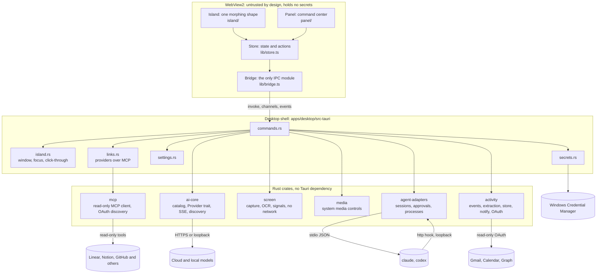
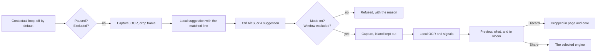
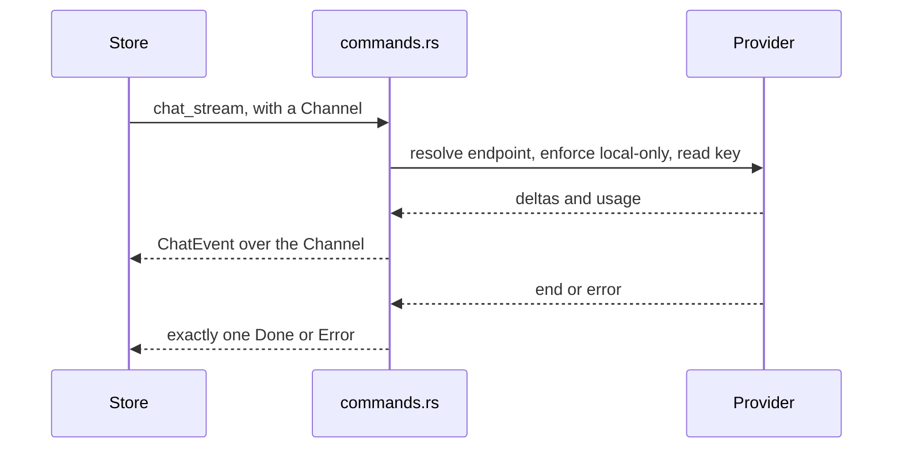
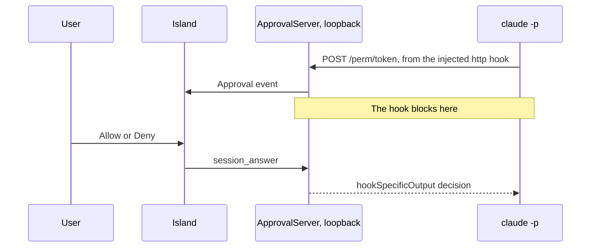

# Architecture

Meridian is a Tauri 2 application. A React interface renders the island inside one transparent window, and a Rust core
owns everything that touches the machine: the window, keys, network and child processes.

## Boundaries

| Unit | Owns | Depends on |
|---|---|---|
| `island/machine.ts` | Which state shows, and its size, as pure functions | Nothing |
| `island/line.ts` | The shape of the listening line, as pure functions | Nothing |
| `island/faces.tsx` | The registry of faces, and blinking | Nothing |
| `island/live.ts` | Live activities, as pure functions of an event and the time | Nothing |
| `island/Island.tsx` | The morph, and reporting the shape to Rust | Motion, store |
| `lib/store.ts` | App state and every action | Bridge |
| `lib/bridge.ts` | The whole IPC surface | Tauri API |
| `lib/mock.ts` | A browser stand-in for the core, used by UI tests | Nothing |
| `packages/design-system` | Colour, surface and motion tokens | Nothing |
| `src-tauri/island.rs` | Placement, style bits, click-through poll | Win32 |
| `crates/ai-core` | Providers | reqwest |
| `crates/agent-adapters` | Agent sessions | tokio |
| `crates/screen` | Capture, OCR, signals, exclusions. No network code | Win32, WinRT |
| `crates/media` | Media sessions and controls, which players can be heard, and volume, brightness and battery | WinRT, Core Audio, WMI |
| `crates/voice` | Speaking and hearing: cloud services, the Windows voice, and the downloaded local engine | reqwest, WinRT, libloading |
| `crates/activity` | Event model, extraction, store, notifications, connectors | SQLite, reqwest |
| `crates/mcp` | MCP client, sign-in discovery, service catalog, tool choice, turning results into rows | reqwest, `activity` for OAuth |
| `src-tauri/watch.rs` | The contextual screen loop | `screen` |
| `src-tauri/life.rs` | Activity timers, keychain, sign-in, commands | `activity` |
| `src-tauri/links.rs` | Providers over MCP, and OpenRouter sign-in | `mcp` |
| `src-tauri/following.rs` | Following Claude Code from any terminal | `agent-adapters` |
| `src-tauri/voice.rs` | Voice commands, keys and pack downloads | `voice` |
| `src-tauri/update.rs` | Checking for and installing a release through `gh` | `gh` CLI |
| `src-tauri/log.rs` | A redacted log of crashes | Nothing |

The frontend never sees a provider or agent wire format. A provider failure comes back as a typed error, and every chat
ends in exactly one terminal event, so the UI can never be left waiting.

## How the island stays out of the way

The window is fixed and transparent, so a morph is only a change inside the page.

1. Motion springs animate one element's width, height and radius. It hangs from the top of the window, which sits at the
   top of the display's work area.
2. At most once per frame, the page sends the shape to Rust through `island_set_rect`.
3. A poll thread compares the cursor with the shape. Over the shape the window takes the mouse. Anywhere else it is
   click-through, and hover changes reach the page as events.
4. The page waits 180 ms before reacting to hover and 240 ms before reacting to its end, so a passing pointer moves nothing.

Only `WS_EX_TRANSPARENT` changes at runtime. See `docs/DECISIONS.md`, D28.

The page reports its own device pixel ratio, so hit testing stays correct even when WebView2's scale differs from the
window's.

## What the island shows

`deriveView` is a pure priority list, highest first: expanded, listening, screen being read, blocked approval, voice, error,
notification, level, contextual, multitask, working, thinking, media, idle. An approval outranks everything automatic because an
agent is stuck until someone answers. Reading the screen always shows. A suggestion never interrupts active work, and media
only fills an otherwise empty island.

## Unified events

Everything personal becomes one `ContextEvent`, whatever its source, with a dedupe key so an update changes the existing
entry. Every minute `activity::decide` weighs events against preferences, the reminder log, and what the user is doing,
which the store reports to the core. Each reminder fires once, and a reschedule starts a new set. Informational news during
agent work goes to the activity centre, not the island. Quiet hours hold everything except critical.

## Screen

`shareCapture` in the store is the only way screen content leaves the machine.

## Chat

Local-only mode is enforced on the resolved address in Rust, so no interface path can get around it.

## Agent sessions

Each run is one task owning one child process, driven by a channel of commands. Everything comes back as a normalized
`AgentEvent`. Claude Code keeps its process between turns for 3 minutes, so a follow-up is fast, and after that a follow-up
resumes from the transcript under the same session id. The chat and the Agents page are two views of the same sessions.

### Claude Code approval

The hook exists for that run alone, passed through `--settings`, so the user's configuration is never written.

Codex approvals arrive as server requests on the same JSON-RPC pipe, and are answered on it.

## Adding things

| To add | Do this |
|---|---|
| A provider with an OpenAI-style API | One row in `crates/ai-core/src/catalog.rs` |
| A provider with its own protocol | A module implementing `Provider`, plus a `Protocol` variant |
| A coding agent | A module with its own `run` loop in `crates/agent-adapters`, plus an `AgentKind` variant |
| An island state | A `deriveView` rule, a size in `machine.ts`, a view in `views.tsx` |

Stubs for later subsystems do not exist on purpose. See `docs/DECISIONS.md`, D17.

## Path to macOS and Linux

Frontend, `ai-core`, `activity` and most of `agent-adapters` are portable. Windows-specific code sits in `island.rs`,
`glass.rs`, `secrets.rs`, `life.rs` keychain code, the process-tree kill in `process.rs`, and all of `screen` and `media`.
Those would need a platform split.
