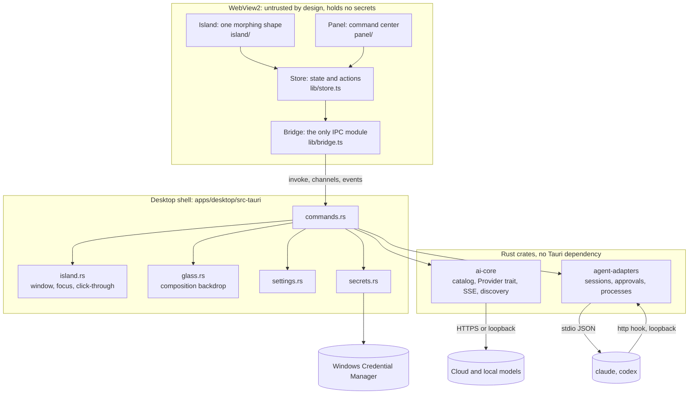
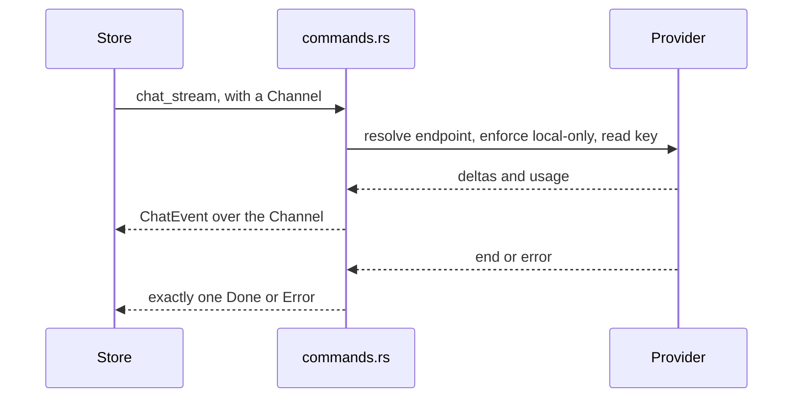
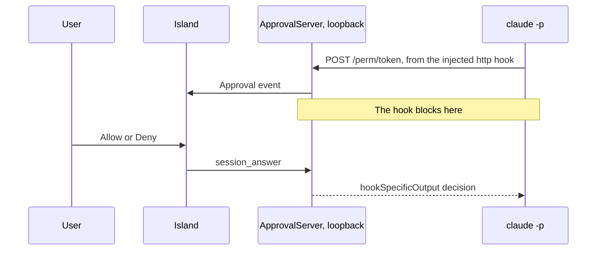

# Architecture

Meridian is a Tauri 2 application. A React interface renders the island inside one transparent window, and a Rust core
owns everything that touches the machine: the window, keys, network and child processes.

## Boundaries

| Unit | Owns | Depends on |
|---|---|---|
| `island/machine.ts` | Which state shows, and its size, as pure functions | Nothing |
| `island/line.ts` | The shape of the line of light, as pure functions | Nothing |
| `island/Island.tsx` | The morph, and reporting the shape to Rust | Motion, store |
| `lib/store.ts` | App state and every action | Bridge |
| `lib/bridge.ts` | The whole IPC surface | Tauri API |
| `lib/mock.ts` | A browser stand-in for the core, used by UI tests | Nothing |
| `packages/design-system` | Colour, surface and motion tokens | Nothing |
| `src-tauri/island.rs` | Placement, style bits, click-through poll | Win32 |
| `src-tauri/glass.rs` | The blurred backdrop, entirely optional | WinRT Composition |
| `crates/ai-core` | Providers | reqwest |
| `crates/agent-adapters` | Agent sessions | tokio |

The frontend never sees a provider or agent wire format. A provider failure comes back as a typed error, and every chat
ends in exactly one terminal event, so the UI can never be left waiting.

## How the island stays out of the way

The window is fixed and transparent, so a morph is only a change inside the page.

1. Motion springs animate one element's width, height and radius.
2. At most once per frame, the page sends the shape to Rust through `island_set_rect`.
3. Rust moves the backdrop visual to match, on the main thread that owns it.
4. A poll thread compares the cursor with the shape. Over the shape the window takes the mouse. Anywhere else it is
   click-through, and hover changes reach the page as events.

The page reports its own device pixel ratio, so hit testing stays correct even when WebView2's scale differs from the
window's.

## What the island shows

`deriveView` is a pure priority list, highest first: expanded, listening, blocked approval, error, notification,
contextual, multitask, working, thinking, idle. An approval outranks everything automatic because an agent is stuck until
someone answers. A suggestion never interrupts active work.

## Chat

Local-only mode is enforced on the resolved address in Rust, so no interface path can get around it.

## Agent sessions

Each session is one task owning one child process, driven by a channel of commands. Everything comes back as a normalized
`AgentEvent`. A session retires at its terminal event, not when its process finally exits, so a follow-up can resume it
straight away.

### Claude Code approval

The hook exists for that run alone, passed through `--settings`, so the user's configuration is never written.

Codex approvals arrive as server requests on the same JSON-RPC pipe, and are answered on it.

## Adding things

| To add | Do this |
|---|---|
| A provider with an OpenAI-style API | One row in `crates/ai-core/src/catalog.rs` |
| A provider with its own protocol | A module implementing `Provider`, plus a `Protocol` variant |
| A coding agent | A module with its own `run` loop in `crates/agent-adapters`, plus an `AgentKind` variant |
| An island state | A `deriveView` rule, a size in `machine.ts`, a view in `views.tsx` |

Stubs for later subsystems do not exist on purpose. See `docs/DECISIONS.md`, D17.

## Path to macOS and Linux

Frontend, `ai-core` and most of `agent-adapters` are portable. Windows-specific code sits in `island.rs`, `glass.rs` and
`secrets.rs`, and the process-tree kill in `process.rs`. Those would need a platform split.
